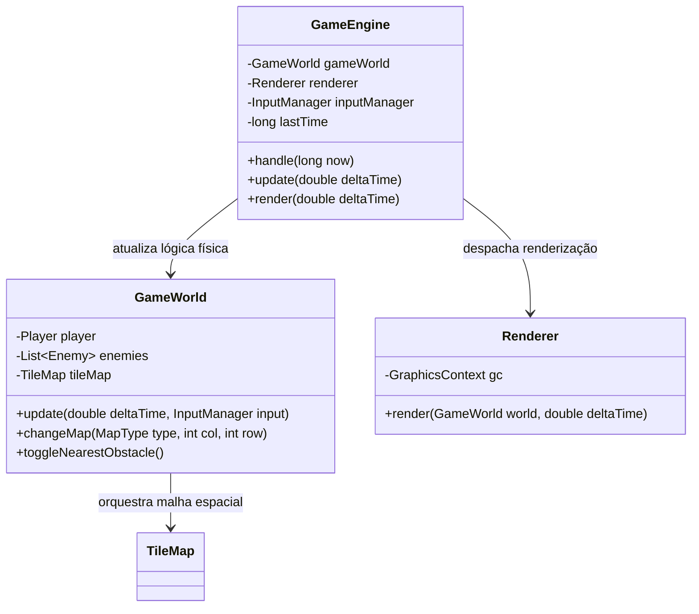
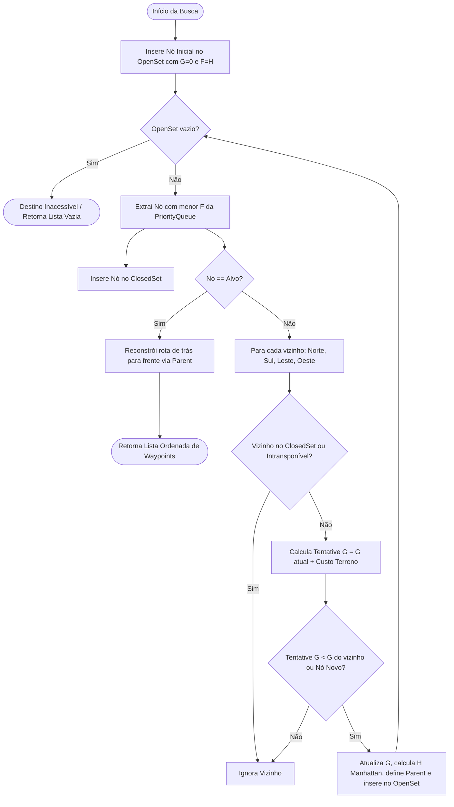
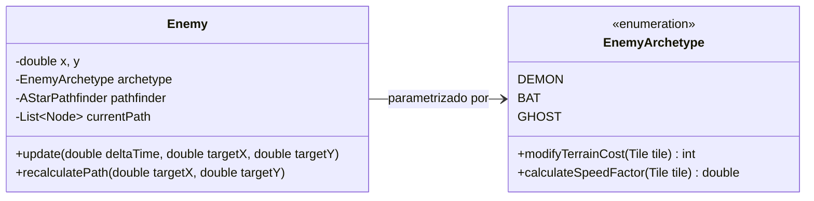
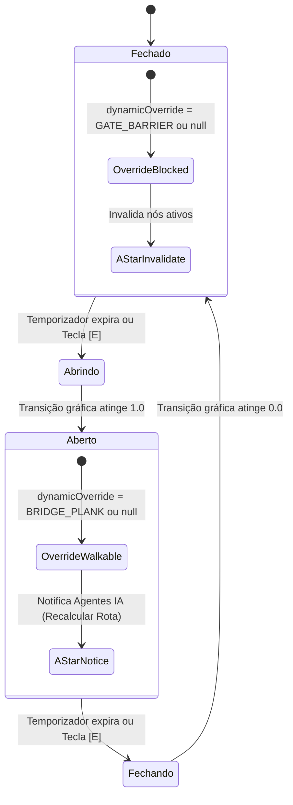
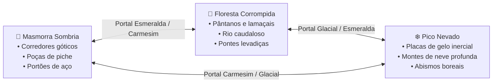

# 🗡️ Project Fade to Black — Motor de Simulação, IA Heurística e Físicas 2D

> Um simulador de Action RPG 2D top-down desenvolvido integralmente em **Java 17 e JavaFX**. O sistema implementa navegação autônoma multi-agentes baseada em **Busca Heurística Informada ($A^*$)**, modelagem de grafos com pesos variáveis de terreno, perturbações dinâmicas de cenário (portões mecânicos e pontes móveis), topologia multi-biomas interligada por portais e **telemetria em tempo real sobre a cabeça das entidades** para diagnóstico algorítmico contínuo.

---

## 📑 Sumário

1. [Visão Geral e Demonstração Visual](#-visão-geral-e-demonstração-visual)
2. [Arquitetura de Software e Game Loop](#-arquitetura-de-software-e-game-loop)
3. [Representação Espacial do Ambiente (TileMap e Colisões AABB)](#-representação-espacial-do-ambiente-tilemap-e-colisões-aabb)
4. [Algoritmo de Busca Heurística A* (A-Star)](#-algoritmo-de-busca-heurística-a-a-star)
5. [Sistema Multi-Agentes e Arquétipos Autônomos](#-sistema-multi-agentes-e-arquétipos-autônomos)
6. [Física de Terrenos e Modificadores de Deslocamento](#-física-de-terrenos-e-modificadores-de-deslocamento)
7. [Obstáculos Dinâmicos e Perturbações em Tempo de Execução](#-obstáculos-dinâmicos-e-perturbações-em-tempo-de-execução)
8. [Topologia de Biomas e Portais Dimensionais](#-topologia-de-biomas-e-portais-dimensionais)
9. [Painel de Telemetria em Tempo Real (Overhead HUD)](#-painel-de-telemetria-em-tempo-real-overhead-hud)
10. [Controles Operacionais e Instruções de Execução](#-controles-operacionais-e-instruções-de-execução)

---

## 📸 Visão Geral e Demonstração Visual

Todas as imagens abaixo foram capturadas diretamente do motor gráfico em execução, demonstrando a convergência dos algoritmos de busca, os diferentes biomas e a instrumentação matemática ativa.

### 1. Masmorra Sombria — Perseguição Multi-Agente em Malha com Piche
Demonstração dos três agentes autônomos perseguindo simultaneamente o jogador. O algoritmo de busca contorna automaticamente o portão central trancado pelo corredor lateral aberto e pondera o alto custo das poças de piche negro.


---

### 2. Floresta Corrompida — Rios, Pontes Levadiças e Pântano
O rio divide a topologia do mapa. A ponte levadiça norte está abaixada (*ABERTO*), permitindo a passagem dos agentes, enquanto a ponte sul erguida (*FECHADO*) atua como barreira intransponível, obrigando o A* a recalcular o trajeto. O Demônio tem sua velocidade severamente reduzida ao atravessar o piche.


---

### 3. Pico Nevado — Superfícies Glaciais de Gelo, Neve Densa e Abismos
Neste bioma, o jogador experimenta a física de baixa tração sobre placas de gelo translúcidas (*deslizamento inercial a 135% de velocidade*), contrastando com a neve profunda que impõe 65% de penalidade motora.


---

### 4. Obstáculos Dinâmicos — Reatividade de Rotas em Portões e Pontes
Demonstração de perturbação dinâmica do grafo: com pontes e portões simultaneamente fechados, os agentes reconhecem em tempo real a ausência de conectividade (*Passos: 0 / Rota Inexistente*), retomando o deslocamento no instante exato da reabertura mecânica.


---

### 5. Telemetria e Diagnóstico dos Algoritmos de IA sobre a Cabeça
Visão ampliada dos painéis flutuantes de diagnóstico (*Overhead HUD*). O sistema expõe a equação de custo $F = G + H$, a latência em microssegundos/milissegundos, nós explorados na fila de prioridade, contagem de waypoints e modificadores físicos de velocidade.


---

## ⚙️ Arquitetura de Software e Game Loop

O motor adota o padrão de projeto **Game Loop Desacoplado**, implementado através do `javafx.animation.AnimationTimer`. 



### O Desacoplamento Temporal ($\Delta t$)
Para assegurar que simulações físicas e velocidades permaneçam perfeitamente idênticas em qualquer monitor (seja a 60 Hz, 144 Hz ou com quedas momentâneas de processamento), todo deslocamento é integrado multiplicando pelo delta de tempo em segundos:

$$x_{t + \Delta t} = x_t + v_x \cdot \Delta t$$
$$y_{t + \Delta t} = y_t + v_y \cdot \Delta t$$

Um limitador rígido ($\Delta t_{max} = 0.1\text{ s}$) atua como proteção contra o fenômeno de *spiral of death* ou transposição involuntária de barreiras sólidas (*tunneling*).

---

## 🗺️ Representação Espacial do Ambiente (TileMap e Colisões AABB)

O universo físico é modelado como uma **Matriz Bidimensional Discreta** de $20 \times 15$ células, onde cada célula mede $40 \times 40\text{ pixels}$. Essa matriz atua simultaneamente como:
1. **Camada de Renderização Gráfica:** Projeta texturas e detalhes pixel art.
2. **Camada de Simulação Física:** Delimita superfícies transitáveis e barreiras sólidas.
3. **Grafo de Navegação:** Fornece os nós e pesos de arestas para a Inteligência Artificial.

```
       Coluna 0     Coluna 1     Coluna 2     ...   Coluna 19
Linha 0 [ Parede ]   [ Parede ]   [ Parede ]         [ Parede ]
Linha 1 [ Parede ]   [ Portal ]   [  Piso  ]         [ Parede ]
Linha 2 [ Parede ]   [  Piso  ]   [  Lama  ]         [ Parede ]
  ...      ...          ...          ...                ...
Linha 14[ Parede ]   [ Parede ]   [ Parede ]         [ Parede ]
```

### Detecção de Colisão AABB Desacoplada por Eixos
Para verificar se uma entidade de largura $W$ e altura $H$ pode se deslocar, o sistema projeta sua caixa delimitadora (*Axis-Aligned Bounding Box*) contra a matriz em 4 vértices críticos:

$$\text{Superior Esquerdo: } (\lfloor x / S \rfloor, \lfloor y / S \rfloor)$$
$$\text{Superior Direito: } (\lfloor (x + W - \epsilon) / S \rfloor, \lfloor y / S \rfloor)$$
$$\text{Inferior Esquerdo: } (\lfloor x / S \rfloor, \lfloor (y + H - \epsilon) / S \rfloor)$$
$$\text{Inferior Direito: } (\lfloor (x + W - \epsilon) / S \rfloor, \lfloor (y + H - \epsilon) / S \rfloor)$$

Onde $S = 40$ (tamanho do tile) e $\epsilon = 0.01$ (margem infinitesimal que impede falso bloqueio de borda).

> **Desacoplamento de Eixos:** O teste de colisão é executado separadamente para o eixo $Y$ e para o eixo $X$. Esse desacoplamento permite que o personagem "escorregue" suavemente pelas paredes ao se mover diagonalmente em cantos, eliminando travamentos bruscos.

---

## 🧠 Algoritmo de Busca Heurística A* (A-Star)

O algoritmo **$A^*$** é uma técnica de busca informada em grafos que encontra o caminho de custo mínimo entre um ponto de partida (posição atual do inimigo) e um ponto de destino (posição do jogador), balanceando a distância já percorrida com a estimativa heurística do trajeto restante:

$$\mathbf{F(n) = G(n) + H(n)}$$

* **$G(n)$ — Custo Real Acumulado:** O esforço exato somado da origem até o nó $n$. Cada passo adiciona o custo de travessia do terreno visitado:
  $$G(vizinho) = G(atual) + C_{terreno}(vizinho)$$
* **$H(n)$ — Custo Heurístico Estimado:** Um cálculo matemático otimista da distância restante até o alvo. Como o jogo opera em movimentação ortogonal cardeal (Norte, Sul, Leste, Oeste), adota-se a **Heurística de Manhattan**:
  $$H(n) = |col_n - col_{alvo}| + |row_n - row_{alvo}|$$
* **$F(n)$ — Custo Total de Prioridade:** Determina qual nó da fronteira deve ser expandido prioritariamente.



### Garantias Teóricas: Admissibilidade e Consistência
1. **Admissibilidade ($h(n) \le h^*(n)$):** A distância de Manhattan em linha reta nunca excede a distância de menor custo possível no mapa. Por nunca superestimar o custo real, o $A^*$ tem garantia matemática de encontrar a **solução ótima**.
2. **Consistência (Desigualdade Triangular):** Para qualquer nó $n$ e vizinho $n'$, temos $h(n) \le c(n, n') + h(n')$. Isso assegura que quando um nó é fechado, a rota ótima até ele já foi descoberta, dispensando reavaliações e garantindo máxima eficiência computacional.

### Estruturas de Dados e Complexidade
- **`openSet` (Fila Aberta):** Implementada via `java.util.PriorityQueue<Node>`. Utiliza a interface `Comparable<Node>` para manter a árvore binária ordenada pelo menor $F(n)$, permitindo extração em tempo $O(\log V)$.
- **`closedSet` (Conjunto Fechado):** Implementado via `java.util.HashSet<Node>` com métodos `hashCode()` e `equals()` mapeados sobre as coordenadas discretas $(col, row)$, fornecendo checagem de pertinência em tempo $O(1)$.

---

## 👾 Sistema Multi-Agentes e Arquétipos Autônomos

Em vez de agentes com comportamento idêntico variando apenas vida ou dano, o sistema implementa **três arquétipos com fisiologias e percepções algorítmicas distintas**:



### Análise Comparativa dos Agentes:

| Arquétipo | Papel e Percepção | Velocidade Base | Modificador Biológico no $A^*$ | Comportamento Reativo |
| :--- | :--- | :---: | :--- | :--- |
| **Demônio** *(Bruiser)* | Terrestre pesado; audição apurada e visão frontal. | $95\text{ px/s}$ | Pondera custo integral do terreno ($1.0\times$). Evita lamaçal e piche quando há rotas alternativas. | Entra em **FÚRIA MELEE** (+30% de velocidade: $123.5\text{ px/s}$) quando a distância euclidiana ao jogador é $< 160\text{ px}$. |
| **Morcego** *(Predador Alado)* | Aéreo ágil; percepção por eco-caçada (ondas sonoras). | $135\text{ px/s}$ | Resistência alada: atenua o custo de terrenos acidentados pela metade: $C_{efetivo} = \max(1, \lfloor (C+1)/2 \rfloor)$. | Cadência ultrarrápida de recálculo no $A^*$ ($0.28\text{s}$), interceptando curvas de forma dinâmica. |
| **Espírito** *(Espectro)* | Espectral incorpóreo; visão radial 360 graus. | $105\text{ px/s}$ | **Imunidade etérea total:** Qualquer terreno transitável tem custo $1.0$ e velocidade nominal $1.0\times$. | Levitação constante sem produzir ruído e sem sofrer atolamento em poças ou rios. |

---

## 🌾 Física de Terrenos e Modificadores de Deslocamento

O motor desacopla o custo de busca do $A^*$ da velocidade física instantânea do ator. O `TileMap` processa múltiplos biomas com propriedades físicas únicas:

$$\text{Velocidade Efetiva} = \text{Velocidade Base} \times \mu_{terreno}$$

| Terreno | Identificador | Custo $G$ no $A^*$ | Multiplicador $\mu$ | Efeito Físico e Comportamental |
| :--- | :---: | :---: | :---: | :--- |
| **Pedra / Grama / Neve** | `STONE_FLOOR` / `GRASS` / `SNOW_FLOOR` | **1** | $1.00\times$ (100%) | Atrito nominal. Deslocamento sem restrições. |
| **Lamaçal Denso** | `MUD` | **2** | $0.50\times$ (50%) | Redução moderada de velocidade por viscosidade de solo. |
| **Piche Viscoso** | `TAR` | **4** | $0.25\times$ (25%) | Atolamento extremo. Velocidade cai para um quarto da base. |
| **Neve Profunda** | `DEEP_SNOW` | **3** | $0.35\times$ (35%) | Resistência mecânica densa, induzindo os inimigos a buscar desvios. |
| **Gelo Escorregadio** | `ICE` | **1** | $1.35\times$ (135%) | Superfície lisa sem atrito com física inercial de derrapagem. |
| **Muralhas / Água / Abismo** | `WALL` / `WATER` / `ABYSS` | $\infty$ | $0.00\times$ (Bloqueado) | Barreira sólida intransponível (`walkable = false`). |

### Modelagem Física Inercial no Gelo
Ao caminhar sobre o `ICE`, o Paladino deixa de ter aceleração instantânea e passa a obedecer a equações de **conservação de momento e decaimento inercial**:

$$\mathbf{v}_{t + \Delta t} = (\mathbf{v}_t + \mathbf{a}_{input} \cdot \Delta t) \cdot \mu_{atrito}^{\Delta t \cdot 60}$$

Onde $\mu_{atrito} = 0.94$ e $\mathbf{a}_{input} = 600\text{ px/s}^2$. O jogador experimenta derrapagem autêntica e precisa controlar o contra-esterço.

---

## 🚪 Obstáculos Dinâmicos e Perturbações em Tempo de Execução

O mundo físico contém mecanismos autônomos que alteram a conectividade do grafo dinamicamente:
1. **Portões de Ferro (*Gates*):** Grades maciças que fecham corredores estratégicos.
2. **Portas Deslizantes (*Sliding Doors*):** Barreiras laterais motorizadas.
3. **Pontes Levadiças (*Drawbridges*):** Plataformas de madeira erguidas por correntes sobre rios e abismos.



### Adaptação Reativa dos Agentes
Ao contrário de sistemas ingênuos onde inimigos colidem cegamente contra portas fechadas:
- Cada obstáculo emite uma notificação de mudança de malha para a classe `GameWorld`.
- Os inimigos inspecionam os próximos nós planejados. Se o portão fechar à frente de um inimigo, o caminho é invalidado imediatamente e o $A^*$ é disparado no mesmo quadro, descobrindo rotas de contorno alternativas.

---

## 🌀 Topologia de Biomas e Portais Dimensionais

O jogo conecta três biomas geograficamente e esteticamente distintos em um anel topológico contínuo:



- **Mecânica de Transição Segura:** Ao pisar sobre o tile de um `Portal`, a coordenada central do jogador é comparada com a área de tolerância do vórtice. O mapa de destino é instanciado e os agentes de IA são posicionados em nós estratégicos do novo bioma, ativando um *cooldown* de $1.5\text{s}$ para evitar oscilações instantâneas entre mundos.

---

## 📊 Painel de Telemetria em Tempo Real (Overhead HUD)

Para viabilizar a auditoria científica do funcionamento dos algoritmos em tempo real, cada ator carrega sobre sua cabeça um painel translúcido de telemetria:

```
┌────────────────────────────────────────────────────────┐
│ [Demônio] PERSEGUINDO (FÚRIA MELEE)                   │
│ A* Lat: 0.35 ms | Nós Explorados: 42 | Passos: 7      │
│ Score Rota F: 21 (Custo Real G: 11 + Heurística H: 10)│
│ Vel: 85 px/s | Terreno: Lamaçal Denso (Custo: 2)      │
└────────────────────────────────────────────────────────┘
```

### Variáveis Monitoradas:
1. **Estado Comportamental:** Registra o modo deliberativo do agente (`PERSEGUINDO`, `FÚRIA MELEE`, `ECO-CAÇADA`, `FLUTUANDO`).
2. **Latência de Busca ($A^* \text{ Lat}$):** Tempo gasto pela CPU na execução do método `findPath()`, mensurado em microssegundos com `System.nanoTime()` e formatado em milissegundos ($ms$).
3. **Volume de Nós Explorados:** Total de células abertas e fechadas na fila de prioridade, mensurando o custo algorítmico da exploração espacial.
4. **Decomposição do Custo:** Revela numericamente o valor de $F(n)$, a porção acumulada $G(n)$ de esforço de terreno e a distância heurística restante $H(n)$ até o Paladino.
5. **Passos Restantes:** Contagem decrescente dos waypoints pendentes da trajetória.
6. **Mecânica Motora:** Velocidade real calculada confrontada com a velocidade inata do personagem e o status de atrito (`NORMAL`, `LENTIDÃO -50%`, `ATOLADO -75%`, `DESLIZANDO +35%`).

---

## 🎮 Controles Operacionais e Instruções de Execução

### Tabela de Comandos

| Tecla | Ação | Descrição Técnica |
| :---: | :--- | :--- |
| **`W`, `A`, `S`, `D`** ou **Setas** | Movimentação | Aplica vetor de deslocamento com checagem de colisão AABB desacoplada. |
| **`E`** ou **`ESPAÇO`** | Acionamento Mecânico | Inverte o estado de abertura/fechamento do obstáculo dinâmico a até 100 px. |
| **`H`** | Alternar HUD de Telemetria | Alterna ciclicamente entre os modos **Completo** (4 linhas de métricas), **Compacto** e **Oculto**. |
| **`T`** | Teletransporte Imediato | Transita ciclicamente entre os 3 biomas do jogo para testes de rotas. |
| **`F12`** | Captura de Tela | Exporta instantaneamente um frame rasterizado em PNG de alta definição para `docs/screenshots/`. |

---

### Como Executar o Projeto

O projeto utiliza o **Maven Wrapper** embarcado, eliminando a necessidade de instalar ferramentas de compilação adicionais na máquina hospedeira.

#### Pré-requisitos
- **Java (JRE ou JDK) 17** ou superior instalado e disponível no terminal (`JAVA_HOME` ou no `PATH`).

---

### 📦 Execução via Pacote Compilado Standalone (Fat JAR)

O projeto foi configurado com o `maven-assembly-plugin` e um ponto de inicialização `Launcher` desacoplado do Classpath para gerar um **arquivo executável único (`sentinela.jar`)**, que incorpora todo o código-fonte compilado e o runtime completo do JavaFX.

Isso significa que **você pode enviar apenas o arquivo `sentinela.jar` para qualquer computador com Java 17+ instalado**, sem precisar que a outra máquina tenha Maven, Maven Wrapper, JDK completo ou JavaFX SDK configurados!

#### 1. Como gerar o arquivo compilado (`sentinela.jar`):
```powershell
.\mvnw.cmd package -DskipTests
```
O Maven gerará o executável standalone na pasta raiz e em `target/sentinela.jar` (~9.1 MB).

#### 2. Como rodar em qualquer PC (apenas com JRE 17+):
Basta copiar o arquivo `sentinela.jar` (e opcionalmente o script `jogar.bat`) para a máquina de destino e executar:

**Via Terminal / Prompt de Comando / PowerShell:**
```powershell
java -jar sentinela.jar
```

**Ou via scripts rápidos de inicialização:**
- **No Windows:** Dê duplo clique no arquivo `jogar.bat`.
- **No Linux / macOS:** Execute no terminal `./jogar.sh`.

---

### 🛠️ Execução em Modo de Desenvolvimento (Maven Wrapper)

Caso queira executar diretamente a partir do código-fonte utilizando o Maven Wrapper embarcado:

#### Execução Interativa:

**No Windows (PowerShell / Prompt de Comando):**
```powershell
.\mvnw.cmd clean javafx:run
```

**No Linux ou macOS (Bash):**
```bash
./mvnw clean javafx:run
```

#### Exportação Autônoma de Capturas de Tela:
O motor possui uma rotina automatizada que simula os biomas, recalcula o A* e regrava as 5 imagens de demonstração técnica:
```powershell
.\mvnw.cmd javafx:run "-Djavafx.args=--capture-screenshots"
```

---

*Project Fade to Black — Engenharia de Software, Algoritmos Heurísticos e Simulação Física 2D.*
