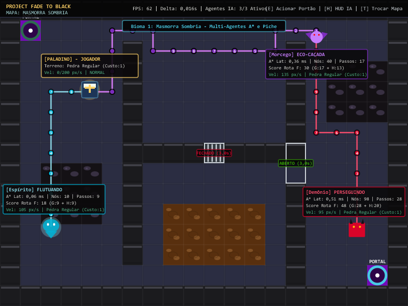
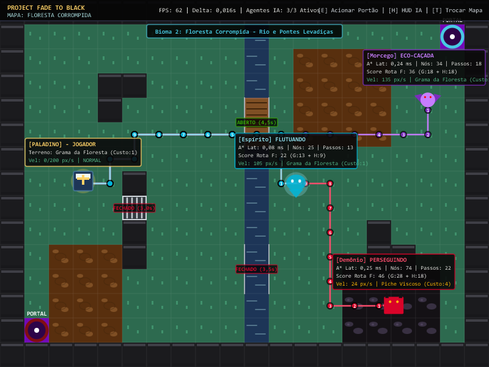
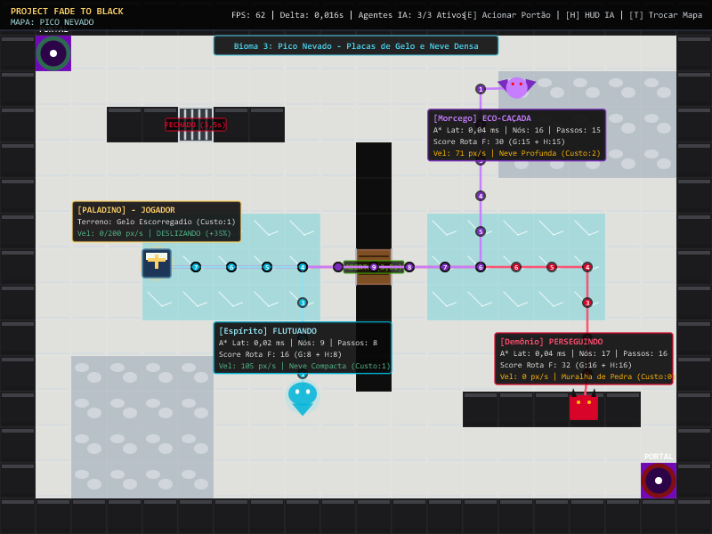
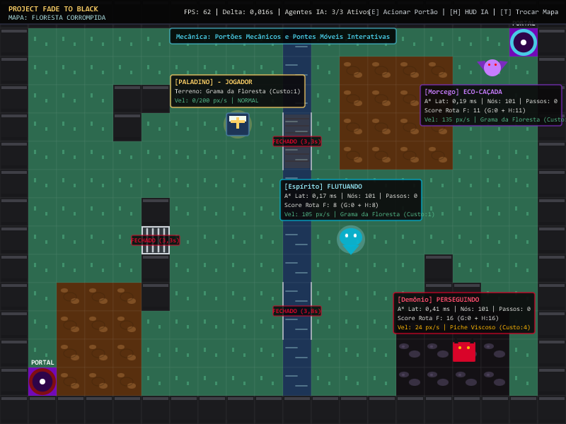
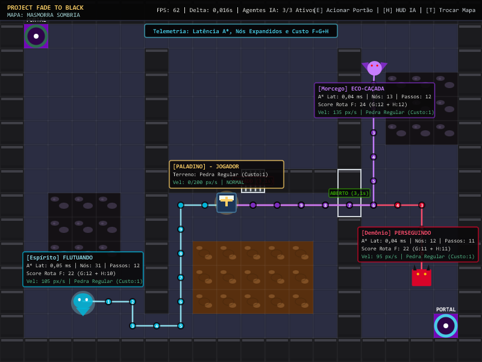
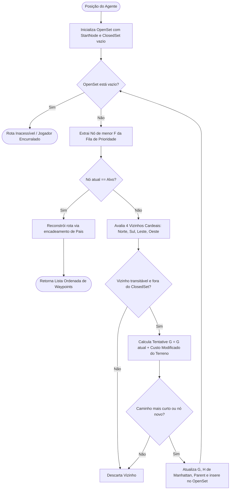
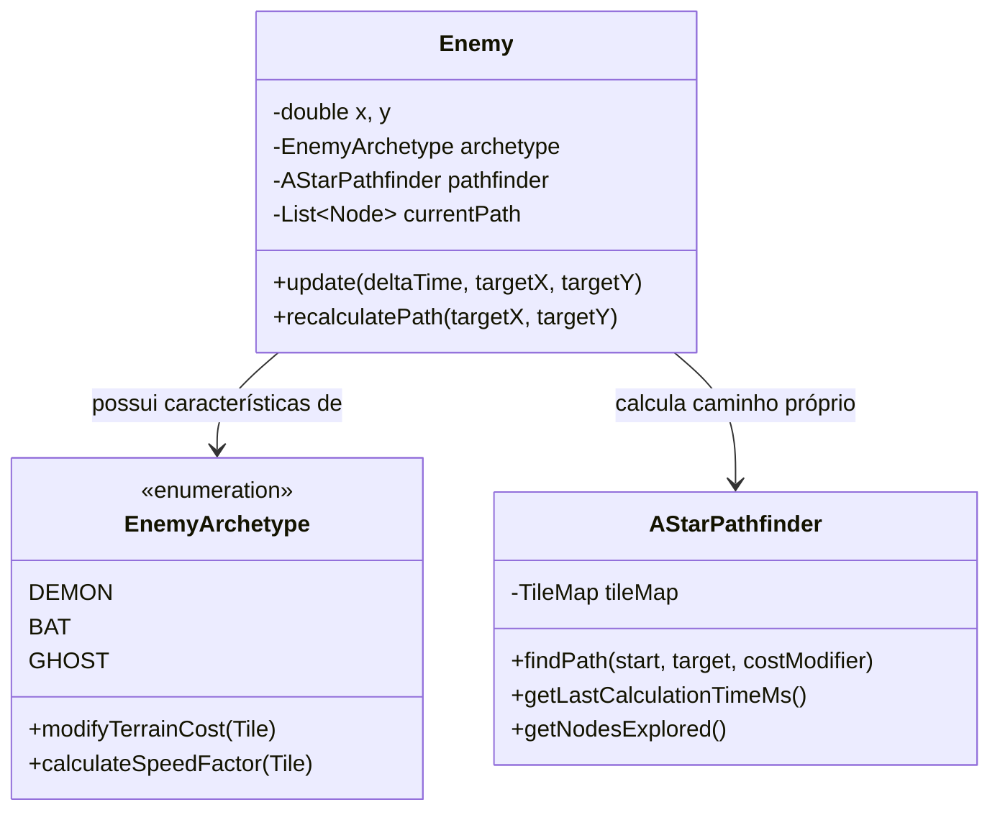
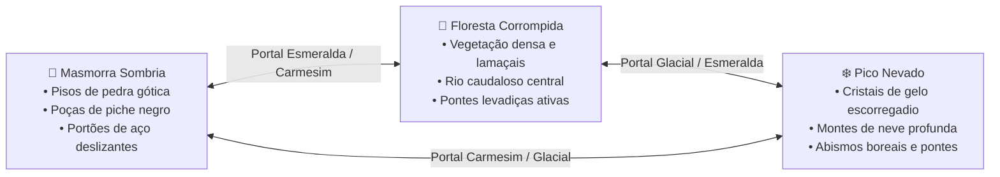
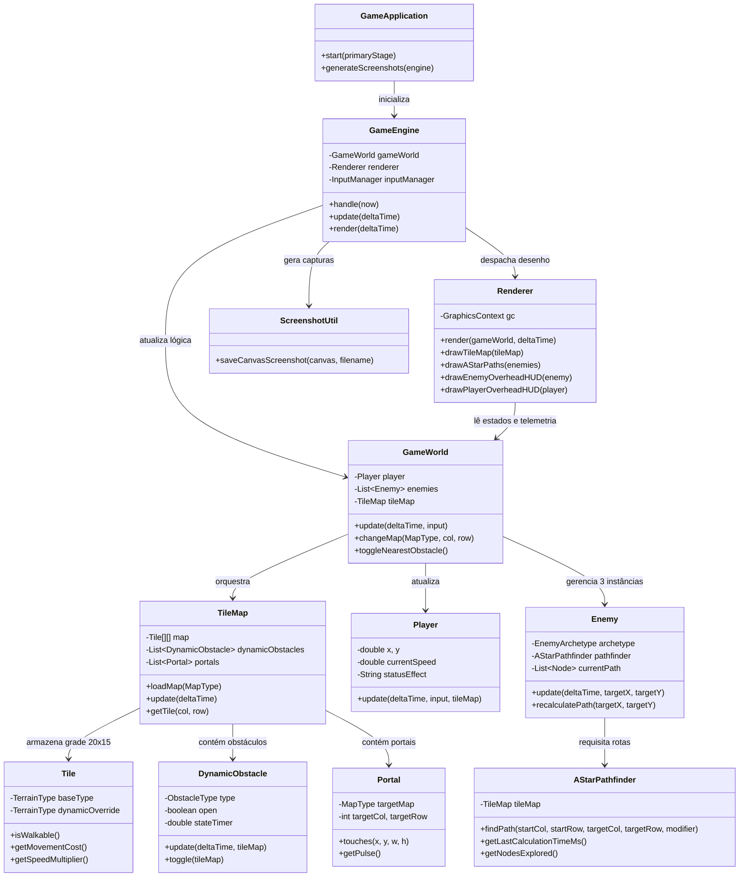

# 🗡️ Project Fade to Black - Motor de IA e Simulação Multi-Agentes

> **Projeto Final de Inteligência Artificial**  
> Um ARPG (Action Role-Playing Game) 2D top-down com temática *Dark Fantasy*, construído integralmente em **Java 17 e JavaFX**. O projeto implementa navegação autônoma multi-agentes baseada no **algoritmo de busca heurística A* (A-Star)**, pesos dinâmicos de terreno, obstáculos mecânicos interativos (portões e pontes móveis), múltiplos biomas conectados por portais dimensionais e **telemetria em tempo real sobre a cabeça de cada entidade** para auditoria dos algoritmos de IA.

---

## 📸 Demonstração Visual e Capturas de Tela

Todas as capturas de tela abaixo foram extraídas diretamente do motor em tempo de execução, demonstrando a fidelidade das implementações algorítmicas, os três arquétipos de agentes autônomos, as superfícies com penalidade de velocidade e a instrumentação matemática dos personagens.

### 1. Masmorra Sombria — Perseguição Multi-Agente com A* e Piche Viscoso
Demonstração dos três arquétipos de inimigos perseguindo ativamente o Paladino. Observe o desvio da rota do Demônio pelo corredor lateral aberto enquanto o portão central permanece trancado, além das poças de piche negro e lamaçal.


---

### 2. Floresta Corrompida — Rios, Pontes Levadiças e Lamaçais
O rio central divide a floresta em duas margens. A ponte norte está estendida (*ABERTO*), permitindo a travessia das criaturas, enquanto a ponte sul erguida (*FECHADO*) atua como barreira intransponível, forçando o recálculo do A*. O Demônio sofre desaceleração severa ao atravessar a poça de piche (redução para 24 px/s).


---

### 3. Pico Nevado — Superfícies Glaciais de Gelo, Neve Densa e Abismos
Neste bioma boreal, o jogador caminha sobre placas de gelo translúcidas com física de conservação inercial (*deslizamento a 135% de velocidade*), ao mesmo tempo em que trechos de neve profunda impõem penalidade de 65% na velocidade de deslocamento.


---

### 4. Obstáculos Dinâmicos — Portões de Aço e Pontes Móveis Interativas
Comprovação da adaptação algorítmica: quando todas as pontes e portões estão fechados, os agentes A* reconhecem a inacessibilidade do alvo (*Passos: 0 / Rota Inexistente*), retomando o avanço imediatamente no milissegundo em que a passagem mecânica se abre.


---

### 5. Telemetria e Diagnóstico dos Algoritmos de IA sobre a Cabeça
Visão detalhada dos painéis de telemetria flutuantes (*Overhead HUD*). O sistema expõe em tempo real o custo total da rota ($F = G + H$), a latência de cálculo em milissegundos ($A^* \text{ Lat}$), a quantidade de nós avaliados na fila de prioridade, o número de passos pendentes e os modificadores físicos de velocidade do terreno.


---

## 🛠️ Tecnologias e Fundações de Engenharia

- **Linguagem:** Java 17 LTS (compilado com flag `--release 17`).
- **Framework de Renderização e Janela:** OpenJFX (JavaFX 17.0.2).
- **Gerenciador de Build e Dependências:** Apache Maven Wrapper (`mvnw` / `mvnw.cmd`).
- **Arquitetura de Software:** Modular (Java Platform Module System - JPMS), Orientação a Objetos estrita, Padrão de Game Loop desacoplado via delta temporal (`AnimationTimer`).
- **Teoria dos Grafos:** Algoritmo A* com Heurística de Manhattan, Fila de Prioridade indexada (`PriorityQueue`), Conjunto Fechado com tabela hash (`HashSet`), e ponderação de arestas dependente da biologia do agente.

*(Desenvolvido do zero, sem engines prontas como Unity ou Godot, a fim de expor a matemática pura dos algoritmos de busca e física em matrizes bidimensionais).*

---

## 🎮 Controles e Comandos de Operação

| Tecla | Função no Jogo | Descrição Operacional |
| :--- | :--- | :--- |
| **`W`, `A`, `S`, `D`** ou **Setas** | Movimentação do Jogador | Desloca o Paladino pelo cenário com verificação de colisão AABB desacoplada por eixos. |
| **`E`** ou **`ESPAÇO`** | Acionar Obstáculo Próximo | Abre ou fecha manualmente o portão de aço ou ponte levadiça mais próxima do jogador. |
| **`H`** | Alternar HUD de Telemetria | Alterna ciclicamente entre o modo **Completo** (4 linhas de métricas de IA), **Compacto** e **Oculto**. |
| **`T`** | Trocar de Mapa Imediatamente | Comando de teste rápido: viaja ciclicamente entre Masmorra $\to$ Floresta $\to$ Neve. |
| **`F12`** | Captura de Tela (Screenshot) | Captura instantaneamente a tela do jogo em PNG de alta definição e salva na pasta `docs/screenshots/`. |

---

## 🧠 Algoritmo A* (A-Star) e Inteligência Artificial

A navegação autônoma de cada inimigo é governada pelo algoritmo de busca informada em grafos **A***, operando sobre a malha de nós da matriz do mapa:

$$\mathbf{F(n) = G(n) + H(n)}$$

Onde:
- **$G(n)$ — Custo Real Acumulado:** O esforço físico somado para transitar da célula inicial até o nó $n$, somando os custos de travessia do terreno de cada tile percorrido.
- **$H(n)$ — Custo Heurístico Estimado:** Distância de Manhattan admissível do nó $n$ até a posição central do jogador:
  $$H(n) = |col_n - col_{alvo}| + |row_n - row_{alvo}|$$
- **$F(n)$ — Custo Total de Prioridade:** Determina a ordem de expansão na fila de prioridade (`PriorityQueue<Node>`), garantindo que o caminho encontrado seja sempre ótimo e com o menor custo de esforço possível.



---

## 👾 Os 3 Arquétipos de Inimigos Autônomos

Para atender às exigências acadêmicas e de design de IA, o sistema conta com **três arquétipos com comportamentos, físicas e percepções distintas**:



### Detalhamento dos Arquétipos:

| Inimigo | Papel Tático | Velocidade Base | Modificador de Terreno no A* | Reação Comportamental da IA |
| :--- | :--- | :--- | :--- | :--- |
| **Demônio** *(Bruiser)* | Guarda pesado de ataque corpo a corpo | $95\text{ px/s}$ | Paga custo integral ($1\times$). Evita piche e lama quando possível. | Entra em estado de **FÚRIA MELEE** (+30% de velocidade) ao se aproximar a menos de 160 px do jogador. |
| **Morcego** *(Predador Alado)* | Assediador aéreo ágil e veloz | $135\text{ px/s}$ | Resistência alada: penalidade de lama/neve cortada pela metade ($C_{efetivo} = \frac{C+1}{2}$). | Utiliza **ECO-CAÇADA**. Perseguição rápida com alta taxa de amostragem no A* ($0.28\text{s}$). |
| **Espírito** *(Espectro Corrompido)* | Espectro flutuante transpassador | $105\text{ px/s}$ | Imunidade etérea: custo de terreno é sempre $1$. Ignora atolamento e lama. | **FLUTUAÇÃO TRANSCENDENTAL**. Deslocamento constante sem sofrer qualquer atrito ou lentidão em biomas adversos. |

---

## 🌾 Terrenos com Dificuldade de Movimentação

O jogo implementa múltiplos tipos de piso com características mecânicas e heurísticas próprias, influenciando diretamente a velocidade de caminhada dos personagens e as rotas escolhidas pelo A*:

| Terreno | Custo no A* ($G$) | Modificador de Velocidade | Efeito Físico e Comportamental |
| :--- | :---: | :---: | :--- |
| **Pedra Regular / Grama / Neve** | **1** | $1.00\times$ (100%) | Terreno padrão sem qualquer atrito ou penalidade de locomoção. |
| **Lamaçal Denso** | **2** | $0.50\times$ (50%) | **Lentidão moderada.** Reduz pela metade a velocidade de deslocamento de quem pisa sobre ele. |
| **Piche Viscoso** | **4** | $0.25\times$ (25%) | **Atolamento severo.** O personagem perde 75% da sua velocidade, ficando praticamente imobilizado. |
| **Neve Profunda** | **3** | $0.35\times$ (35%) | **Neve acumulada.** Dificulta passos rápidos e força os inimigos inteligentes a contornar o trecho. |
| **Gelo Escorregadio** | **1** | $1.35\times$ (135%) | **Superfície sem atrito.** Acelera o jogador em 35% e ativa a mecânica inercial de deslizamento e derrapagem. |
| **Água Profunda / Abismo / Muralha** | $\infty$ | $0.00\times$ (Intransponível) | Bloqueio físico absoluto. Nós marcados como `walkable = false` no grafo. |

---

## 🚪 Obstáculos Dinâmicos e Mecânicos

O sistema integra três tipos de obstáculos móveis gerenciados pela classe `DynamicObstacle`:
1. **Portões de Aço (Gates):** Grades reforçadas que fecham corredores estratégicos.
2. **Portas Deslizantes (Sliding Doors):** Painéis maciços que deslizam lateralmente nas paredes.
3. **Pontes Levadiças (Drawbridges):** Estruturas de pranchas de madeira suspensas por correntes sobre rios de água profunda ou abismos glaciais.

### Sincronização em Tempo Real com o A*:
- **Ciclo Temporal Automático:** Cada obstáculo possui temporizadores independentes de abertura e fechamento (ex: aberto por 4.0s, fechado por 3.5s).
- **Acionamento Manual:** O jogador pode pressionar `E` ou `Espaço` a até 100 pixels de distância para forçar a abertura ou fechamento da passagem.
- **Invalidação Instantânea de Rota:** Quando um obstáculo altera seu estado, a malha de transitabilidade do `TileMap` é atualizada e **todos os agentes de IA são notificados imediatamente**. Caso a porta feche no nariz de um inimigo, ele não fica preso; seu A* descarta a rota bloqueada e calcula instantaneamente uma rota alternativa contornando pelo outro lado do mapa.

---

## 🌀 Biomas e Portais Dimensionais

O mundo do jogo é composto por **três mapas temáticos interconectados**:



- **Mecânica dos Portais:** O jogador é teleportado suavemente ao pisar no vórtice arcano central de um portal. O sistema possui um temporizador de *cooldown* de 1.5s para evitar teleportes em loop infinito.

---

## 📊 Sistema de Telemetria e Diagnóstico de IA

Para atender ao rigor de avaliação acadêmica de algoritmos de Inteligência Artificial, o projeto conta com um **sistema de telemetria visual flutuante sobre a cabeça de cada personagem**:

### Métricas Exibidas no Overhead do Inimigo:
```
┌────────────────────────────────────────────────────────┐
│ [Demônio] PERSEGUINDO (FÚRIA MELEE)                   │
│ A* Lat: 0.35 ms | Nós Explorados: 42 | Passos: 7      │
│ Score Rota F: 21 (Custo Real G: 11 + Heurística H: 10)│
│ Vel: 85 px/s | Terreno: Lamaçal Denso (Custo: 2)      │
└────────────────────────────────────────────────────────┘
```
- **Identificação e Estado da IA:** Indica se o agente está em patrulha, perseguição direta, fúria melee, eco-caçada ou flutuação espectral.
- **Latência do A* ($\text{ms}$):** Tempo medido em microssegundos com `System.nanoTime()` demonstrando a eficiência computacional do algoritmo.
- **Nós Explorados:** Quantidade de vértices expandidos na fila de prioridade até a convergência da rota.
- **Custo $F = G + H$:** Transparência matemática das fórmulas heurísticas adotadas pelo agente.
- **Passos Restantes:** Contagem decrescente de waypoints pendentes para alcançar o jogador.
- **Velocidade e Terreno:** Confirmação de que as penalidades de velocidade estão sendo aplicadas conforme a matriz de terrenos.

---

## 🏗️ Arquitetura de Classes do Sistema

O diagrama abaixo detalha a estrutura de classes de todo o projeto:



---

## 🚀 Como Executar o Jogo

O projeto possui o **Maven Wrapper** embarcado, eliminando a necessidade de instalar manualmente o Maven no sistema operacional.

### Pré-requisitos
- **Java Development Kit (JDK) 17** ou superior instalado e configurado no ambiente (`JAVA_HOME`).

### Passo a Passo

1. **Abra o terminal** na pasta raiz do repositório:
   ```bash
   cd sentinela
   ```

2. **Execute o jogo** com o comando correspondente ao seu sistema:

   **No Windows (PowerShell / CMD):**
   ```powershell
   .\mvnw.cmd clean javafx:run
   ```

   **No Linux ou macOS (Bash):**
   ```bash
   ./mvnw clean javafx:run
   ```

3. **Geração Automatizada de Capturas de Tela:**  
   Para reexportar todas as capturas de tela dos 3 mapas e das métricas de IA de forma autônoma:
   ```powershell
   .\mvnw.cmd javafx:run "-Djavafx.args=--capture-screenshots"
   ```

---

## 👥 Autoria e Contexto Acadêmico

- **Disciplina:** Projeto de Inteligência Artificial
- **Tema:** ARPG 2D Top-Down com IA Multi-Agentes e Busca Heurística em Grafos
- **Projeto:** *Fade to Black (Operação Sentinela)*
- **Licença:** MIT License
